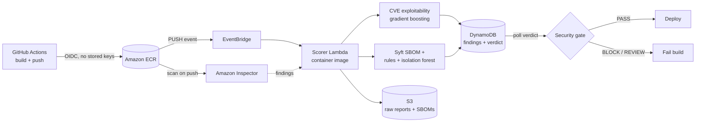

# CloudSentry

**Cloud-native container security pipeline on AWS.** Every image pushed to Amazon ECR is scanned automatically, its CVEs are re-ranked by a machine-learning exploitability model, its dependency list (SBOM) is checked for supply-chain tampering, and a GitHub Actions gate blocks deployment when the verdict is risky.



---

## Why

A typical container image ships with over 100 known vulnerabilities. Teams can't patch all of them, and the default way to prioritize, sorting by CVSS severity, measures *how bad a bug would be if exploited*, not *how likely it is to be exploited*. CVE scanners also can't see supply-chain tampering that doesn't have a CVE yet: a typosquatted package, a dropped-in binary, an attack tool hidden inside a base image.

CloudSentry addresses both:

| Problem | Component | Approach |
|---|---|---|
| Which CVEs actually matter? | **CVE exploitability classifier** | Supervised ML (gradient boosting) trained on NVD features, labeled with CISA KEV + EPSS |
| Has this image been tampered with? | **SBOM drift detector** | Hard rules for known-bad patterns + unsupervised isolation forest on build-to-build dependency drift |
| Stop risky images from shipping | **CI security gate** | GitHub Actions job that reads the verdict and fails the build |

---

## How it works

1. **Push.** GitHub Actions builds the image and pushes it to ECR, authenticating with OIDC (short-lived credentials, nothing stored in the repo).
2. **Scan.** ECR enhanced scanning triggers Amazon Inspector automatically.
3. **Trigger.** EventBridge catches the ECR `PUSH` event and invokes the scorer Lambda.
4. **Wait.** The Lambda polls Inspector until the scan is complete *and* the finding count has stopped changing (see [Engineering findings](#engineering-findings)).
5. **Score CVEs.** Each finding gets an `exploit_score` from the gradient-boosted model.
6. **Check the SBOM.** The Lambda runs Syft against the image in ECR, applies the rules, diffs the result against the repo's last clean SBOM, and scores the drift with the isolation forest.
7. **Store.** Raw findings and SBOMs go to S3. One row per finding, plus one `SBOM_ANALYSIS` verdict row, goes to DynamoDB.
8. **Gate.** The GitHub workflow polls DynamoDB for the verdict, writes a results table to the job summary, and only lets the deploy job run if the gate passes.

**Gate policy**
- SBOM verdict `BLOCK` (offensive tool or typosquat found) → fail
- SBOM verdict `REVIEW` (anomalous drift) → fail
- Any *fixable* CVE with exploit score ≥ `CVE_THRESHOLD` (default 0.95) → fail

---

## Component 1: CVE exploitability classifier

**Notebook:** [`notebooks/01_cve_exploitability_classifier.ipynb`](notebooks/01_cve_exploitability_classifier.ipynb)

**Data**
- **Features:** NVD JSON 2.0 feeds, 2019–2026, CVEs with CVSS v3.1 (249,200 CVEs). Attack vector, complexity, privileges, user interaction, scope, C/I/A impact, base/exploitability/impact scores, CWE (top 30), reference count, and exploit/patch reference tags.
- **Label:** exploited = in **CISA KEV** *or* **EPSS ≥ 0.1**. 6,374 positives (2.6%).
- EPSS is used **only for the label**, never as a feature, so the model can't just copy it.

**Evaluation.** Because the classes are heavily imbalanced, accuracy is meaningless, so I report **PR-AUC** and **recall at a fixed 5% remediation budget** ("if you patch only the top 5% of CVEs the model flags, what share of exploited ones do you catch?").

| Split | Model | PR-AUC | Recall @ top 5% |
|---|---|---|---|
| Random (inflated, see below) | CVSS baseline | 0.060 | 14.7% |
| | Logistic regression | 0.164 | 35.5% |
| | Gradient boosting | 0.232 | 42.8% |
| **Time split: train < 2024, test 2024** | Random guessing | ~0.024 | 5% |
| | CVSS baseline | 0.058 | 16.7% |
| | **Gradient boosting** | **0.098** | **21.9%** |

**The time-split numbers are the honest ones.** The random split let the model train on future CVEs, and a CVE-age feature leaked "older = more time to be exploited" into the model. After switching to a time split and dropping `age_days`, gradient boosting still beats CVSS by **~1.7x on PR-AUC** and catches **~31% more exploited CVEs** at the same patching budget. Testing on 2025+ CVEs was rejected because their labels haven't matured (only 0.9% positive): many will be exploited later.

**Context:** FIRST's EPSS took the same path (logistic regression in v1, XGBoost from v2 on) but uses over 1,000 features, including live threat intelligence. This model uses only public NVD metadata, so its value is an exploitability estimate at disclosure time, before EPSS has history on a CVE.

**In production,** features come from a bundled NVD snapshot. CVEs too new for the snapshot fall back to features parsed from Inspector's own CVSS vector, and each finding records which source it used (`features_source`).

> Scores are **ranks, not probabilities**. The model was trained with `class_weight="balanced"`, so 0.93 means "riskier than most," not "93% chance of exploitation." Calibration is listed under future work.

---

## Component 2: SBOM supply-chain drift detection

**Notebook:** [`notebooks/02_sbom_drift_detection.ipynb`](notebooks/02_sbom_drift_detection.ipynb)

### Attempt 1: compare images to each other (failed)
I generated SBOMs for 40 official images with Syft and trained an isolation forest on per-image composition features. **Detection was about 5%, the same as the false positive rate**, so it was guessing. The natural differences between images (busybox has 2 packages, ghost has over 2,000) completely drowned out injected packages.

### Attempt 2: build-to-build drift (shipped)
Real supply-chain attacks show up as **an unexpected change between consecutive builds of the same image**. I rebuilt the detector around that:

- **Training data:** 49 versioned images across 7 series (python, node, nginx, golang, postgres, redis, ruby) → **42 consecutive "normal update" pairs**
- **Drift features:** packages added and removed, size change, new ecosystems, and, among *added* packages only, the fraction that are unlicensed, unversioned, raw binaries, or never seen in any scanned image
- **Evaluation:** **leave-one-series-out.** To score python updates, the model never sees any python history.
- **Threshold:** 95th percentile of out-of-sample normal scores (0.658), giving **7.1% false positives**

**Synthetic tampering results (leave-one-series-out):**

| Attack | k injected | Detection rate | AUC (iForest) | AUC (count-only baseline) |
|---|---|---|---|---|
| Unknown binaries | 1 | 97.6% | 0.976 | 0.841 |
| Swap binaries (package count unchanged) | 1 | 100% | 0.975 | 0.841 |
| Unvetted registry deps | 1 | 95.2% | 0.964 | 0.841 |
| Foreign ecosystem (well-formed package) | 1 | **21.4%** | 0.875 | 0.841 |
| Any attack | 5–50 | 74–100% | 0.95–0.99 | 0.95–1.00 |

For bulk injections, a naive "count added packages" baseline is nearly as good. **The isolation forest earns its place on stealthy changes**: single packages and swaps, where the count barely moves but the *combination* of signals (unlicensed + unversioned + binary + never-seen) is anomalous.

### Hybrid design
Signals that never vary in normal data can't be learned by an isolation forest, so known-bad patterns are handled by rules:

| Layer | Catches | Action |
|---|---|---|
| **Rules** | Offensive tools (nmap, xmrig, masscan, ...), typosquats one edit away from popular PyPI/npm/RubyGems packages | `BLOCK` |
| **Isolation forest** | Unexplained build-to-build drift | `REVIEW` |

Rules were tuned against the clean baseline: dual-use admin tools (netcat, socat) are tracked separately from attack tools, typosquat checks run only on public-registry packages, and known-legitimate near-misses (npm `color` vs `colors`) are allowlisted. Only `PASS` builds become a repo's new baseline, so a blocked image can never poison future comparisons.

---

## End-to-end results

**Demo app builds (pushed for real, processed automatically):**

| Build | Change | Verdict | Anomaly score (threshold 0.658) | Caught by |
|---|---|---|---|---|
| v2 | + lodash | PASS | 0.464 | n/a (normal update) |
| v3 | + nmap | **BLOCK** | 0.698 | Rule **and** isolation forest |
| v4 | + `expres` (typosquat of `express`) | **BLOCK** | 0.578 | Rule only |

v4 is the measured blind spot in action: one well-formed package scored below the threshold, and the typosquat rule covered it.

**GitHub Actions gate:**
- Clean image: **PASS**, 129 CVEs scored, deploy runs
- [`tests/malicious-nmap`](tests/malicious-nmap/Dockerfile): **BLOCK** (`offensive_tools: ['nmap']`, anomaly score 0.705), deploy skipped

To rerun the negative test: **Actions → CloudSentry security gate → Run workflow**, with folder `tests/malicious-nmap`.

> The test images are built locally. The typosquat test package is created from an empty folder, and nothing is downloaded from a malicious source.

---

## Engineering findings

Problems I hit building this on real AWS, and how I fixed them:

**1. Inspector's scan-complete event never arrived.** The original trigger listened for `Inspector2 Scan` / `INITIAL_SCAN_COMPLETE`. Scans finished successfully but the rule never fired. A temporary catch-all EventBridge rule logging every `aws.inspector2` and `aws.ecr` event showed ECR `PUSH` events and per-finding events arriving, but no scan-complete event at all. **Fix:** trigger on the reliable ECR push event, and have the Lambda poll Inspector coverage until the scan finishes.

**2. Inspector findings are eventually consistent.** The *same image* (identical SBOM, identical anomaly score) reported 49, 119, and 129 CVEs on different runs, because Inspector marks a scan `SUCCESSFUL` before all findings are queryable. **Fix:** after the scan completes, poll the finding count until it is unchanged for three consecutive checks. Results are now consistent (129).

**3. GitHub OIDC subject format.** The role's trust policy matched `repo:owner/repo:ref:...`, but GitHub's token carried `repo:owner@<id>/repo@<id>:ref:...`. I found this by decoding the token's claims in a workflow step. The trust policy is now pinned to the **immutable owner and repo IDs plus the `main` branch**, so a renamed or recreated repo, a fork, or another branch can't assume the AWS role.

**4. Script injection in workflow inputs.** The manual-run folder input is passed through an environment variable instead of being interpolated into the shell script, which prevents Actions script injection.

---

## Security design

- **No long-lived credentials.** GitHub assumes an AWS role through OIDC, and the trust is pinned to one repo and one branch.
- **Least privilege throughout.**
  - Lambda role: read Inspector findings, write to one S3 bucket and one DynamoDB table, pull from ECR
  - GitHub role: push to one ECR repository, read one DynamoDB table
  - Dev user: no IAM permissions
- **Fail-safe gate.** No verdict within 15 minutes → the build fails.
- **Baseline integrity.** Only clean builds update the drift baseline.
- **Isolation.** SBOM analysis errors are caught separately, so they can't break CVE scoring.

---

## Repository layout

```
cloudsentry/
├── .github/workflows/cloudsentry-gate.yml   # build → security gate → deploy
├── app/Dockerfile                           # demo application image
├── tests/malicious-nmap/Dockerfile          # negative test: hidden attack tool
├── lambda/
│   ├── handler.py    # entry point: ECR event → wait for scan + findings → score
│   ├── app.py        # Inspector findings → CVE exploitability scoring → S3/DynamoDB
│   ├── sbom.py       # Syft SBOM → rules + drift isolation forest → verdict
│   └── Dockerfile    # Lambda container image (Python 3.12 + Syft + scikit-learn 1.6.1)
├── models/
│   ├── cve_model.joblib       # gradient-boosted exploitability classifier
│   ├── sbom_model.joblib      # isolation forest + threshold + rule lists
│   └── nvd_features.csv.gz    # NVD feature snapshot for scoring
└── notebooks/
    ├── 01_cve_exploitability_classifier.ipynb
    └── 02_sbom_drift_detection.ipynb
```

## AWS resources

| Resource | Name |
|---|---|
| ECR repositories | `cloudsentry-demo-app`, `cloudsentry-scorer` (Lambda image) |
| Inspector | ECR enhanced scanning (scan on push) |
| EventBridge rule | `cloudsentry-image-push` (ECR `PUSH` / `SUCCESS`) |
| Lambda | `cloudsentry-scorer` (container image, 2 GB memory, 4 GB `/tmp`, 15 min timeout) |
| S3 | `raw/{repo}/{digest}/{ts}.json`, `sbom/{repo}/latest.json`, `sbom/{repo}/{digest}.json` |
| DynamoDB | `cloudsentry-findings` (PK `image_digest`, SK `finding_id`) |
| IAM | `cloudsentry-lambda-role`, `cloudsentry-github-actions` (OIDC) |

---

## Limitations

- **Synthetic attacks.** The SBOM detector was evaluated against tampering scenarios I designed. Real attacks may look different.
- **Foreign-ecosystem blind spot.** A single well-formed package from an unexpected ecosystem is detected only 21% of the time.
- **Small drift training set.** 42 update pairs from 7 image families.
- **Uncalibrated CVE scores.** Use them for ranking, not as probabilities.
- **Label noise.** Recent CVEs are under-labeled because exploitation evidence accumulates over time.
- **Infrastructure built by hand.** Resources were created with the console and CLI, not infrastructure as code.
- **Lambda polling.** The Lambda is billed while it waits for Inspector and is capped at 15 minutes.

## Future work

- Define all infrastructure in **Terraform**
- Replace Lambda polling with **Step Functions** (waiting is free, no 15-minute cap)
- **Calibrate** CVE scores (isotonic regression) so the threshold has a probability meaning
- Add NVD **CPE vendor/product** and CVE-description text features to the classifier
- Expand drift training data with more image families and real version histories
- Notify on `REVIEW` verdicts (SNS/Slack) for human triage instead of hard-failing

---

## Tech stack

**AWS:** ECR, Inspector, EventBridge, Lambda (container image), S3, DynamoDB, IAM (OIDC)
**ML:** scikit-learn (HistGradientBoosting, IsolationForest, LogisticRegression), pandas, NumPy
**Security tooling:** Syft (SBOM), NVD, CISA KEV, FIRST EPSS
**CI/CD:** GitHub Actions, Docker
